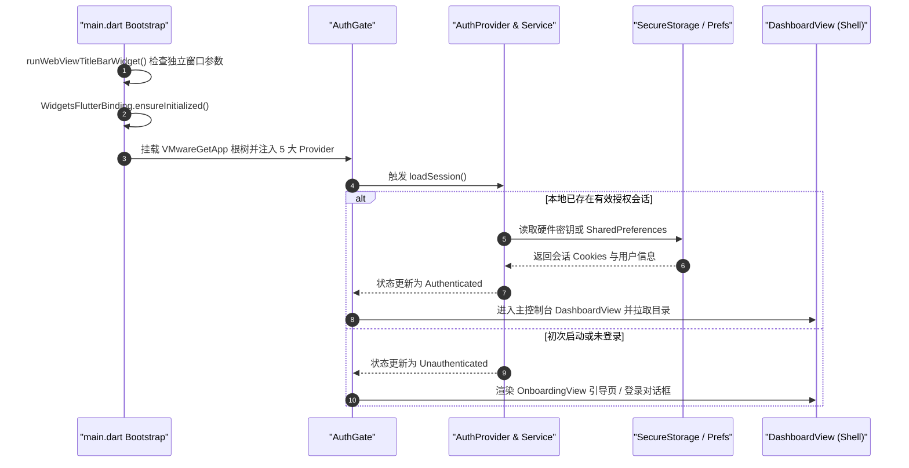
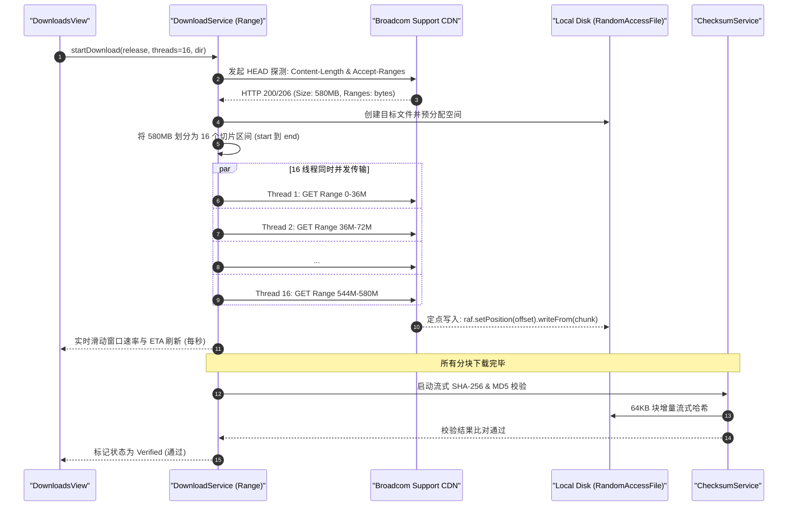

# VMwareGet (io.github.vmwareget)

> **VMware Official Release Companion & Concurrent Transfer Engine**  
> Cross-Platform Desktop Client engineered for PC (macOS, Windows, Linux) with Flutter (v3.47.7 pinned) and Material Design 3.

---

## 1. 概览与核心能力 (Overview & Capabilities)

**VMwareGet** 专为连接 Broadcom 支持门户、检索官方授权软件目录、高速分块并发下载以及自动校验 **VMware Workstation Pro** 与 **VMware Fusion** 官方安装包打造。应用内置端到端防篡改校验引擎，展示包括 **File Name**、**Release Date**、**Last Updated**、**SHA-256** 与 **MD5** 在内的完整技术规格。

- **应用标识 (Bundle ID):** `io.github.vmwareget`
- **框架与运行时:** Flutter 严格锁定至 `3.47.7`，Dart `3.7+`
- **设计系统:** Material Design 3 (MD3)，支持自适应色调种子、响应式 `NavigationRail`/`NavigationBar`、深色/浅色模式平滑切换
- **原生支持平台 (PC):** macOS (Universal & Apple Silicon 优化)、Windows、Linux

---

## 2. 核心架构与功能特性 (Key Architectural Features)

### 2.1 现代身份认证与 CookieJar 管道 (Authentication Pipeline)
- **内嵌原生浏览器免繁琐导入 (WKWebView):** 借助内置的 `desktop_webview_window` 模块，一键弹出安全 Web 视图直达 Broadcom 官方登录页面，登录成功后自动监听并捕获会话 Cookie。
- **智能 Cookie 清洗去重 (`AuthService.compileCookiesForSupportPortal`):** 针对 Broadcom 多重子域重定向导致的多路径重复 Cookie 进行优先权排序与去重，优先保障 `support.broadcom.com` 关键会话，杜绝 400 Bad Request。
- **凭证双层持久化:** 优先存入硬件加密的 Keychain/KeyStore 密钥区（`flutter_secure_storage`），受限环境下自动优雅降级为本地隔离加密存储（`SharedPreferences`）。
- **多种导入模式:** 支持内嵌浏览器抓取、cURL 命令/Cookie 字符串直接粘贴导入、以及本地缓存无缝导入。

### 2.2 100% 动态实时在线目录 (Zero-Hardcoded Catalog)
- **纯动态数据源:** 客户端不内置任何静态或假数据版本，所有发布包、Build 编号、哈希值均实时请求 Broadcom 官方 REST API。
- **实时链路诊断:** 记录每次 API 请求的起止毫秒时间戳、网络延迟以及 Payload 大小。
- **双大产品线快速切换:**
  - **VMware Workstation Pro**（Windows `.exe` / Linux `.bundle`）
  - **VMware Fusion**（macOS Universal `.dmg`）
- **完整规格面板 (Metadata Inspector):** 实时呈现版本、发布时间、更新时间、构建号、文件体积、SHA-256 校验码、MD5 校验码及一键复制。

### 2.3 原生并发切片下载引擎 (Native Range Concurrency Transfer Engine)
- **零外部二进制依赖:** 放弃依赖外部重型下载工具，基于 Dart 原生 HTTP Range 分块与 `RandomAccessFile` 直接按照字节偏移量定点落盘。
- **可调节并发连接数:** 默认 16 线程并发，设置中支持自由设定为 1 ~ 64 线程。
- **动态订单与签名 URL 生成:** 自动调用 `createProductDownloadOrder` 附带 EULA 合规确认，换取受保护的官方 CDN 高速下载链接。
- **断点续传与任务控制:** 原生支持暂停（Pause）、恢复（Resume）、取消与重试。
- **流式防篡改校验:** 安装包下载完成瞬间，由 `ChecksumService` 以 64KB 流式注入计算实际文件的 SHA-256 与 MD5，严格比对官方发布哈希并给出安全徽章。

### 2.4 国际化工程体系 (l10n.yaml + ARB Architecture)
- **标准化代码生成:** 采用 Google 官方推荐的 `l10n.yaml` 构建体系与 ARB 格式规范，支持 ICU 复数与动态参数插值。
- **三语种完备覆盖:**
  - 🇺🇸 **English**（系统默认语言，极简专业术语）
  - 🇨🇳 **简体中文**（遵循“信达雅”翻译原则）
  - 🌐 **Esperanto**（世界语完备翻译包）
- **健壮的 Fallback 机制:** 针对 Flutter 原生 `GlobalMaterialLocalizations` 缺失小众语种（如 `eo`）的问题，工程挂载了兜底 Material/Cupertino Delegates，彻底解决第三方语言导致的白屏/灰屏崩溃。
- **macOS 原生风格选择器:** 采用轻量微阴影（`elevation: 2`）、1px 精致细线描边与系统级双向箭头（`unfold_more_rounded`），视觉质感贴合桌面操作系统。

---

## 3. 系统分层与生命周期剖析 (System Architecture & Lifecycle)

### 3.1 模块分层拓扑图

```
┌────────────────────────────────────────────────────────────────────────┐
│                        Presentation Layer (UI)                         │
│  Views: AuthGate, DashboardView, CatalogView, DownloadsView, Settings  │
│  Widgets: ProductCard, MetadataPanel, DownloadProgressTile, AppLogo    │
└───────────────────────────────────┬────────────────────────────────────┘
                                    │ Watches & Dispatches
┌───────────────────────────────────▼────────────────────────────────────┐
│                  State Management Layer (Provider)                     │
│  • AuthProvider      • CatalogProvider    • DownloadProvider           │
│  • LocaleProvider    • ThemeProvider                                   │
└───────────────────────────────────┬────────────────────────────────────┘
                                    │ Invokes
┌───────────────────────────────────▼────────────────────────────────────┐
│                    Business & Domain Services Layer                    │
│  • AuthService       • CatalogService     • DownloadService (Range)    │
│  • ChecksumService   • DiagnosticService  • FolderPickerService        │
└──────────────────┬─────────────────┬───────────────────┬───────────────┘
                   │                 │                   │
┌──────────────────▼──────┐ ┌────────▼─────────┐ ┌──────▼────────────────┐
│   Data & Persistence    │ │  Network Pipeline│ │ Internationalization  │
│ • SecureStorage         │ │ • Dio HTTP Client│ │ • l10n.yaml           │
│ • SharedPreferences     │ │ • Broadcom REST  │ │ • app_{en,zh,eo}.arb  │
│ • Native File IO (RAF)  │ │ • WKWebView (SSO)│ │ • Fallback Delegates  │
└─────────────────────────┘ └──────────────────┘ └───────────────────────┘
```

### 3.2 启动与状态流转时序



### 3.3 并发切片下载管线时序



---

## 4. 工程目录索引 (Directory Structure)

```
VMwareGet/
├── l10n.yaml                                # Flutter 官方国际化生成配置
├── pubspec.yaml                             # 依赖清单 (Pinned Flutter 3.47.7, generate: true)
├── build.sh                                 # 宿主操作系统自动识别构建脚本
├── scripts/
│   └── package_macos_dmg.sh                 # 现代 Apple diskutil 驱动的 DMG 制作脚本
├── packages/
│   └── desktop_webview_window/              # 内置独立 WebView 原生插件 (消除弃用警告)
├── lib/
│   ├── main.dart                            # 入口点、MultiProvider 注入与 Fallback Delegates
│   ├── l10n/
│   │   ├── app_en.arb                       # 英语主字典 (包含 ICU 变量与说明)
│   │   ├── app_zh.arb                       # 中文字典 (信达雅)
│   │   ├── app_eo.arb                       # 世界语字典 (Esperanto)
│   │   ├── app_localizations.dart           # 自动生成的本地化基类
│   │   └── app_localizations_{en,zh,eo}.dart# 各语种具体实现类
│   ├── models/
│   │   ├── auth_session.dart                # 用户会话、Cookie 清单与认证令牌
│   │   ├── download_item.dart               # 下载任务状态机、传输进度与分块记录
│   │   └── vmware_product.dart              # 产品线、安装包版本、哈希与规格
│   ├── providers/
│   │   ├── auth_provider.dart               # 会话状态管理与登录/退出派发
│   │   ├── catalog_provider.dart            # 动态目录数据、平台过滤与搜索状态
│   │   ├── download_provider.dart           # 下载任务生命周期、并发度与路径配置
│   │   ├── locale_provider.dart             # 语言切换与持久化通知
│   │   └── theme_provider.dart              # MD3 亮暗色模式管理
│   ├── services/
│   │   ├── auth_service.dart                # Cookie 清洗排重、SSO 拦截与安全存储
│   │   ├── catalog_service.dart             # Broadcom 官方 REST 目录数据拉取
│   │   ├── checksum_service.dart            # 流式 SHA-256 / MD5 计算与校验
│   │   ├── diagnostic_service.dart          # 内存时序日志追踪与延迟基准
│   │   ├── download_service.dart            # 原生 Range 并发下载核心引擎
│   │   └── folder_picker_service.dart       # 跨平台文件夹选取服务
│   ├── utils/
│   │   ├── constants.dart                   # 官方 Endpoints、默认配置与存储键名
│   │   ├── formatters.dart                  # 字节体积与时间美化格式化工具
│   │   └── json_utils.dart                  # 防崩溃容错 JSON 反序列化解析器
│   ├── views/
│   │   ├── auth_gate.dart                   # 首屏路由网关与启动状态决策
│   │   ├── catalog_view.dart                # 软件目录主从联动视图
│   │   ├── dashboard_view.dart              # 响应式全局外壳 (NavigationRail / Bar)
│   │   ├── downloads_view.dart              # 传输管理与进度总览
│   │   ├── login_dialog.dart                # 登录弹窗 (内嵌 Web / cURL 导入)
│   │   ├── metadata_panel.dart              # 技术规格面板与哈希复制
│   │   ├── onboarding_view.dart             # 欢迎导览与初次接入页
│   │   └── settings_view.dart               # 并发连接数、语言下拉与存储路径设置
│   └── widgets/
│       ├── app_logo.dart                    # 品牌矢量 Logo
│       ├── checksum_badge.dart              # 哈希胶囊与复制组件
│       ├── diagnostic_dialog.dart           # 诊断日志查看与导出弹窗
│       ├── download_dir_dialog.dart         # 下载存储路径配置弹窗
│       ├── download_progress_tile.dart      # 动态传输卡片 (含控制操作)
│       └── product_card.dart                # 版本发布项卡片
└── test/
    ├── auth_service_test.dart               # Cookie 解析与存储降级测试
    ├── catalog_service_test.dart            # 动态目录与元数据校验测试
    ├── checksum_service_test.dart           # 散列计算与防篡改不匹配测试
    ├── download_provider_dir_test.dart      # 并发线程与路径偏好测试
    ├── json_utils_test.dart                 # 容错反序列化测试
    ├── locale_test.dart                     # 语言包完整性与 Fallback 渲染测试
    └── widget_test.dart                     # 应用冒烟测试
```

---

## 5. 本地开发与构建指南 (Build & Packaging)

### 5.1 环境要求
- **Flutter SDK:** `3.47.7`
- **Xcode:** 15+ (仅针对 macOS 构建)
- **Dart:** `3.7.0` 及以上

### 5.2 运行测试套件
```bash
flutter test
# 输出: 20 项单元测试全绿通过
```

### 5.3 静态代码质量分析
```bash
flutter analyze
# 输出: No issues found! (0 warnings, 0 errors)
```

### 5.4 宿主自动化构建与打包
运行根目录下的通用构建脚本：
```bash
./build.sh
```

- **macOS 构建输出**:
  - 原生应用程序: `build/macos/Build/Products/Release/VMwareGet.app`
  - 纯净 DMG 安装包: `VMwareGet-macOS.dmg`（基于现代 `diskutil image` 引擎制作，0 警告）
- **Linux 构建输出**:
  - Debian 软件包: `VMwareGet-Linux-amd64.deb`
  - RedHat / Fedora 软件包: `VMwareGet-Linux-x86_64.rpm`
- **Windows 构建输出**:
  - 原生可执行安装包: `VMwareGet-Setup.exe`

---

## 6. 未来规划与路线图 (Roadmap & TODO)

- [ ] **TODO: 增加 Android 平台支援 (Android Companion Support)**

### 💡 Android 平台支持的设计与实现思路

虽然 VMware Workstation 与 Fusion 的安装包主要在 PC 端运行，但引入 Android 移动端支持能够扩展应用的使用场景（如：随时随地通过手机关注 Broadcom 官方最新版本动态、查阅变更日志与 SHA-256 校验码，或将下载任务定向分发至本地 NAS 与私有云存储）。

后续实现的大致技术路径规划如下：

1. **WebView 登录鉴权的多态抽象 (Platform-Polymorphic Auth Pipeline)**
   - **现状:** 当前 PC 端使用 `desktop_webview_window` 弹出桌面独立窗口捕获 Cookie。
   - **改造方案:** 抽象 `IWebviewLoginProvider` 统一登录接口。在 Android 平台上引入 Google 官方推荐的 `webview_flutter` 插件或基于 Chrome Custom Tabs 的免翻页体验，以沉浸式 BottomSheet 或全屏 Modal 嵌入登录页面，并监听 CookieJar 捕获 Broadcom 会话。

2. **移动端后台传输与分区存储适配 (Scoped Storage & Background Transfers)**
   - **存储规范:** 适配 Android 10+ 的 Scoped Storage 限制，使用 `saf` 或通过平台存储通道将大文件安全保存至系统的公共 `Download/VMwareGet` 目录。
   - **后台守护:** 针对数百 MB 的官方安装包，在 Android 上引入 `flutter_foreground_task`（前台服务附带通知栏进度指示）或接入 Android 系统的 `WorkManager`，防止应用切到后台时并发 Range 下载管道被系统激进杀死。

3. **UI 触控与小屏响应式适配**
   - 当前系统的全局外壳已支持响应式布局（宽屏使用 `NavigationRail`，窄屏自动切为 Material 3 `NavigationBar`）。
   - 后续仅需针对手机屏幕尺寸优化 `MetadataPanel`（版本规格面板），在手机竖屏下以弹性底部抽屉（`showModalBottomSheet`）形式展示并支持滑动手势，进一步提升单手触控操作体验。

4. **CI/CD 构建与签名接入**
   - 待功能开发完毕后，在 GitHub Actions 工作流中恢复 `build-android` 任务，配置 Android Keystore 自动化签名与 APK/AAB 产物分发。

